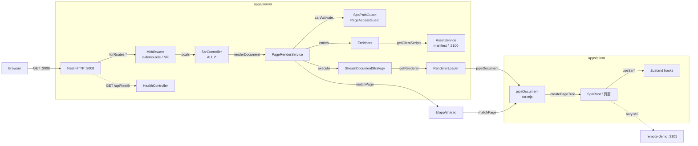
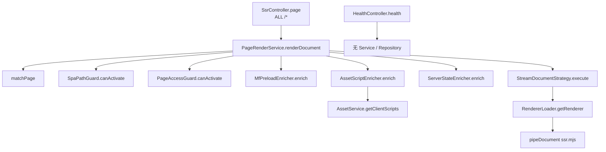
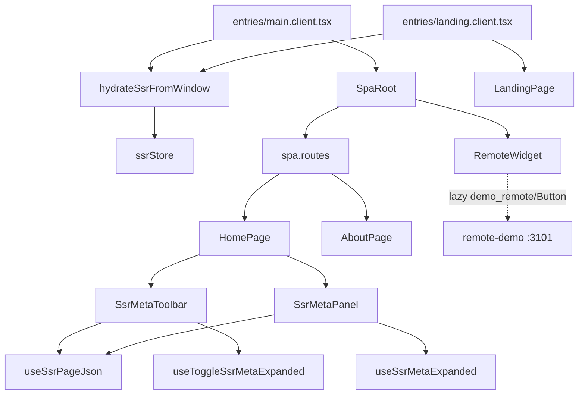
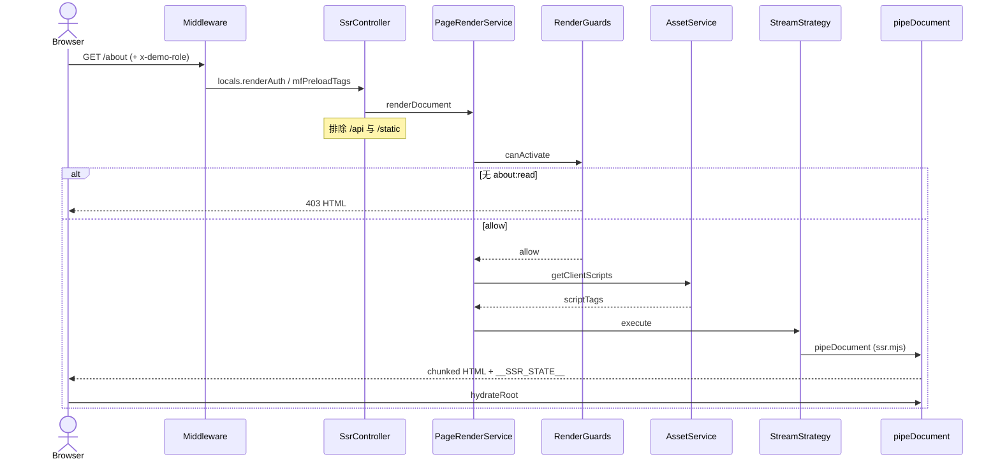

# 架构图与调用链路（structx + archify）

本页归档 **Mermaid** 版本，对应：

| 产物 | 路径 |
|------|------|
| 交互式架构 | [`.archify/architecture-ssr-host-20261025-222200/ssr-host.html`](../.archify/architecture-ssr-host-20261025-222200/ssr-host.html) |
| 交互式时序 | [`.archify/sequence-ssr-document-20261025-222200/ssr-document.html`](../.archify/sequence-ssr-document-20261025-222200/ssr-document.html) |
| 可编辑 draw.io | [diagrams/ssr-architecture.drawio](./diagrams/ssr-architecture.drawio) |
| MCP 配置 | [`.cursor/mcp.json`](../.cursor/mcp.json) |

修订：`8a2b73ce9498d1a831f4e017d417f0380bde5b24`（`https://github.com/huazai128/nest-reactv19.git`）。  
structx 3.4.0 图谱：53 文件、59 函数、5 路由、176 条 `calls` 关系（未跑 LLM `analyze`）。

**archify 不是 MCP**：已作为 Cursor Skill 安装（`npx skills add tt-a1i/archify -g`）。`.cursor/mcp.json` 装的是 **structx** + **drawio-mcp**（stdio，打开编辑器）+ **drawio**（`https://mcp.draw.io/mcp` 聊天内联）。改完 MCP 后请在 Cursor Settings → MCP 启用并重载窗口。

## 1. 系统架构



本仓库 **没有 Repository / 数据库**。I/O 适配器是 `AssetService`（`manifest.json` 或 Rspack `:3100`）和 `RendererLoader`（动态 `import` `apps/client/dist/server/ssr.mjs`）。

## 2. 后端 Controller → Service →（适配器）

structx 已证实：

```text
ALL /*
  SsrController.page
    └─ PageRenderService.renderDocument
      ├─ matchPage                         [@app/shared]
      ├─ createRenderContext
      ├─ guard.canActivate                 （接口，具体 SpaPath / PageAccess）
      ├─ enricher.enrich                   （MF / AssetScript / ServerState）
      │    └─ AssetService.getClientScripts
      └─ streamStrategy.execute
           ├─ RendererLoader.getRenderer
           └─ renderer.pipeDocument        （动态 bundle，未解析到函数 id）
```



| 角色 | 实现 | 说明 |
|------|------|------|
| Controller | `SsrController`、`HealthController` | HTTP 入口；SSR 排除 `/api`、`/static` |
| Service | `PageRenderService`、`MfPreloadService` | 编排与 MF 缓存 |
| 适配器（非 Repository） | `AssetService`、`RendererLoader` | 读文件 / 动态 import，无 DB |
| 横切 | `RequestContextMiddleware`、`MfPreloadMiddleware` | 写入 `res.locals`，不渲染 React |

## 3. 前端组件 / Hook / 请求链路

客户端 **几乎没有 HTTP 请求层**（无 `hooks/` 实现、无 axios/fetch 封装）。页面数据来自 Node 注入的 `window.__SSR_STATE__`。



| 层级 | 位置 | 调用 |
|------|------|------|
| Entry | `entries/main.client.tsx` / `landing.client.tsx` | `hydrateSsrFromWindow` → `hydrateRoot` |
| 路由 | `routes/SpaRoot.tsx`、`spa.routes.tsx` | `HomePage` / `AboutPage`；MPA 链到 `/landing` |
| 页面 | `pages/home`、`about`、`landing` | 首页挂 SSR 元数据组件 |
| Hook | `stores/ssr-store.ts`、`ui-store.ts` | 细粒度 selector；`hooks/` 目录为空 |
| 远程 | `components/RemoteWidget.tsx` | 仅浏览器 `lazy`，SSR 占位 |

SSR 树：`pipeDocument` → `matchPage` → `createPageTree` → `StaticRouter` + `SpaRoot` 或 `LandingPage`。

## 4. 页面请求时序



## 5. 反模式与重构建议

structx 文件导入与调用图 **未发现循环依赖**（`apps/server` 不 import `apps/client` 源码；`@app/shared` 不反向依赖 apps）。`renderer.pipeDocument` / `guard.canActivate` / `enricher.enrich` 因 Nest 接口 + 动态 import，structx 未解析到具体 callee id，属工具限制，不是环。

### 低风险（建议按优先级做）

| 优先级 | 现象 | 建议 |
|--------|------|------|
| P1 | `SpaPathGuard` 硬编码 `/about` + `about:read`，而 `PageAccessGuard` 读 `PAGE_ROUTES.access`（当前 `permissions: []`），权限规则分两处 | 把 SPA 子路径权限写进 `packages/shared` 的 `PAGE_ROUTES`（或独立 access 表），删除 Guard 里的路径特例 |
| P2 | `SsrModule` 同时注册 Controller、Asset、全部 Guard/Enricher/Strategy | 保持可运行；扩展业务模块时再拆 `RenderModule`，不要一次搬空 |
| P3 | `MiddlewareModule` 由 `SsrModule` import，HTTP 横切绑在 SSR 模块上 | 改到 `AppModule` / `modules/index.ts` 注册，Ssr 只消费 `locals` |
| P4 | `render-context.ts` 直接 import `middlewares` 的 `Locals` / `RenderAuthLocals` | 保留契约字段即可；长期可由 Controller 传入 `auth`，render 层不引用 middleware 路径 |
| P5 | `apps/client/src/hooks/` 只有 README，真实 hook 在 `stores/` | 第一笔浏览器 API 再建立 `hooks/useXxx`；不要为了目录完整性空转 |
| P6 | `RemoteWidget.tsx` 无 `@module` 头块；`MfPreloadService` 写死 `localhost:3101` | 补头块；manifest URL 改为 env |

### 高风险（先不要动）

| 项 | 为什么高风险 |
|----|----------------|
| 引入 DB / 伪 Repository 层 | 当前产品是 SSR 宿主演示，没有持久化边界；空 Repository 只会增加跨层噪声 |
| 拆分 `PageRenderService` 与 catch-all `ALL /*` | 流式 HTML、403/503 与 `headersSent` 竞态都集中在这里；无回归测试时易白屏 |
| 改 `RendererLoader` 相对 `ssr.mjs` 路径 | 依赖「本文件上溯 7 级到 `apps/client`」，构建产物一变即 503 |
| 把 `matchPage` 从 `@app/shared` 拆回 server/client 各写一份 | 入口脚本与权限会再次分叉 |
| 用 JWT 直接替换 `Locals.renderAuth` 而不保留字段 | Guard / `ServerStateEnricher` / 前端 `useSsrServerContext` 三处会同时空 |

### 跨层导入（现状）

| 方向 | 结论 |
|------|------|
| client → server 源码 | 无 |
| server → client 源码 | 无；运行时只 `import` **构建产物** `dist/server/ssr.mjs` |
| 两边 → `@app/shared` | 正确契约层 |
| render → middleware | `MfPreloadEnricher`、`createRenderContext` 读 `Locals.*`（弱耦合，可接受） |

### 臃肿 / 职责混杂

- **SsrModule**：组装型模块，50 行，可暂留。
- **PageRenderService**：编排而非业务，职责清楚。
- **SpaPathGuard**：把「示例权限」写进 Guard，与页面模型重复 → P1。
- **HealthController**：探针无 Service，合理。

## 6. MCP 与本地命令

```bash
# 图谱（已 gitignore .structx/）
structx ingest .
structx status .
structx path matchPage
structx overview --repo .

# archify（Skill CLI）
node ~/.agents/skills/archify/bin/archify.mjs finalize architecture \
  .archify/architecture-ssr-host-20261025-222200/candidate.json \
  .archify/architecture-ssr-host-20261025-222200/ssr-host.html \
  --repo-root . --quality showcase --json
```

draw.io：用桌面版或 [app.diagrams.net](https://app.diagrams.net/) 打开 `docs/diagrams/ssr-architecture.drawio`。Cursor 重载 MCP 后可用 `open_drawio_xml` / `open_drawio_mermaid` 再导出一版。
